

# TaskFlow

**A team workspace for tasks, chat, analytics and a private AI assistant, deployed with a full production-style operations stack.**

Built by a team of four at 42 for the `ft_transcendence` project.

`Project Manager` · `DevOps` · `System Design` · `Frontend Design`

 

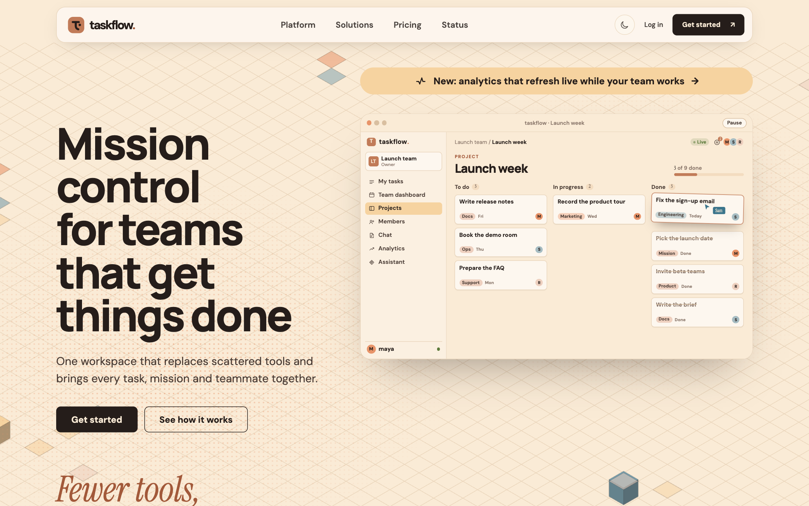

> **Status:** in final validation before the 42 evaluation. A hosted demo is coming. The screenshots use a fictional demo team.

## My role

I'm **Abdelmoula Nemili**. I led TaskFlow from planning to deployment and owned four areas:

| Area | What I did |
| --- | --- |
| **Project management** | Acted as Product Owner and PM: set the backlog and priorities, gave each module one owner, ran the integration branch, and defined "done" as passing automated checks. |
| **System design** | Designed the architecture as technical lead: service boundaries, the single HTTPS entry point, the data and real-time flows, and how a local AI model fits on limited hardware. |
| **DevOps** | Built the Docker stack, Nginx TLS, CI, centralized logging, monitoring and alerts, backups and disaster recovery. |
| **Frontend design** | Designed the visual identity and product UI: palette, typography, icons, the mascot Brainy and the design system. Youssef implemented the screens. |

## The product

<table>
  <tr>
    <td width="50%">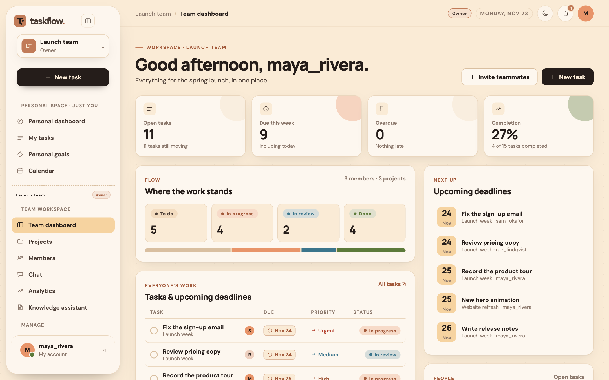 <b>Team dashboard.</b> Workload, deadlines and progress at a glance.</td>
    <td width="50%">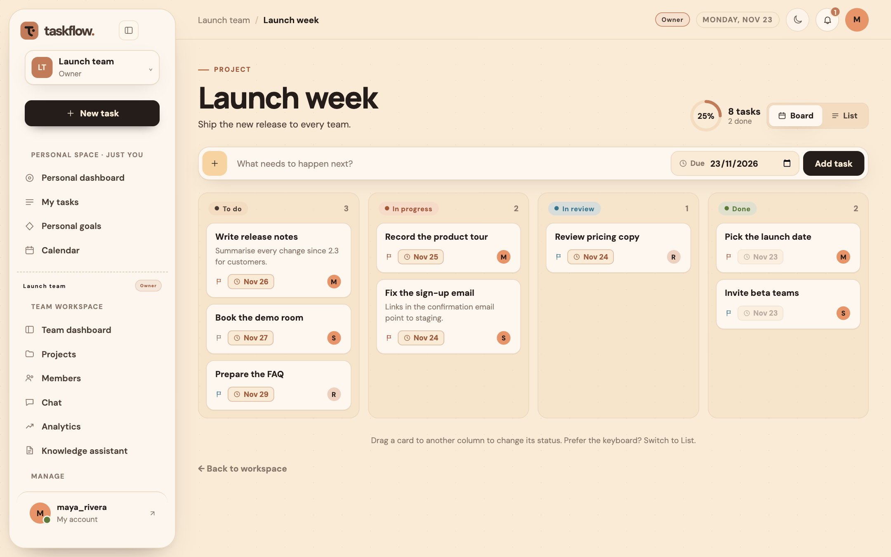 <b>Project board.</b> Drag-and-drop tasks, with safe concurrent edits.</td>
  </tr>
  <tr>
    <td>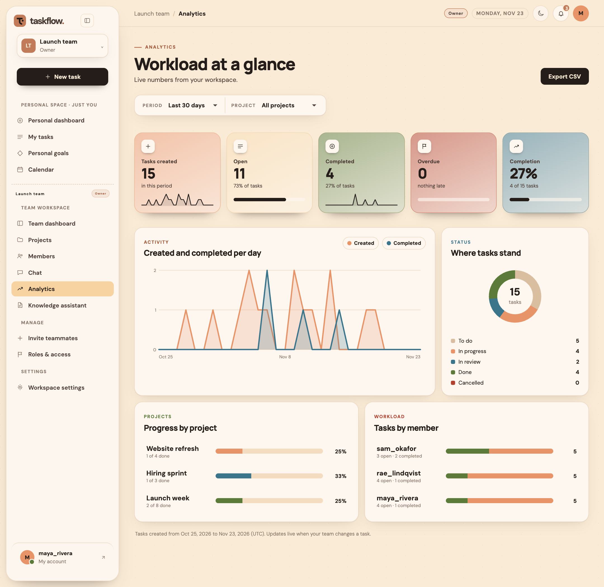 <b>Live analytics.</b> Charts, filters and CSV export, refreshed over WebSockets.</td>
    <td>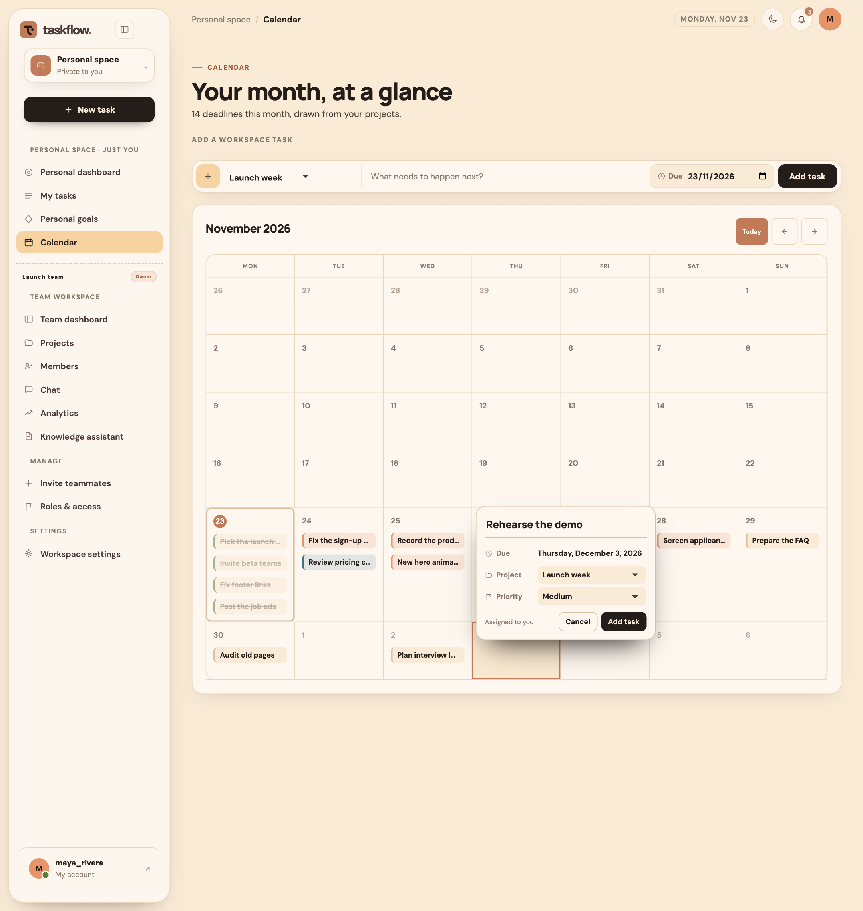 <b>Calendar.</b> Click a day to create a task in place.</td>
  </tr>
  <tr>
    <td>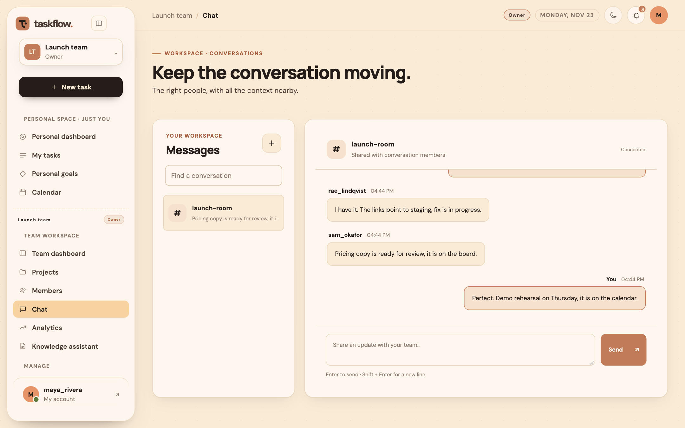 <b>Real-time chat.</b> Workspace conversations with history.</td>
    <td>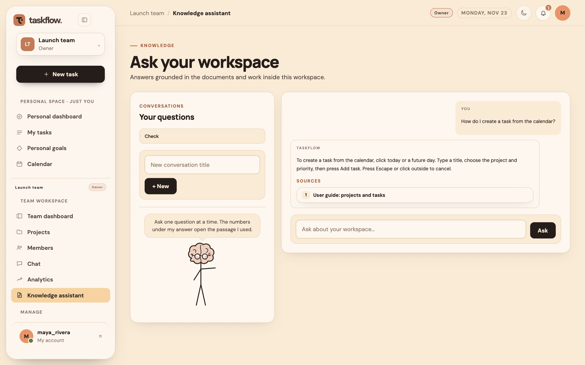 <b>Private AI assistant.</b> A local model answers with cited sources.</td>
  </tr>
  <tr>
    <td>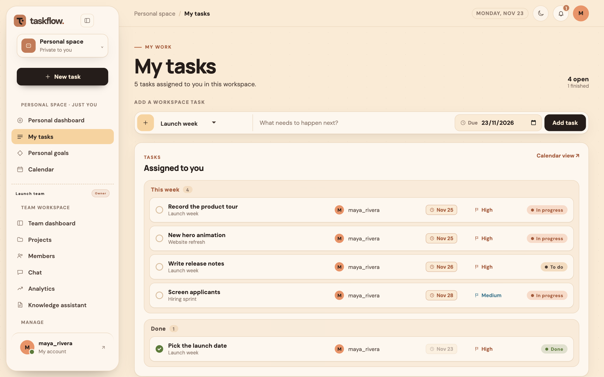 <b>My tasks.</b> Everything assigned to you, grouped by date.</td>
    <td>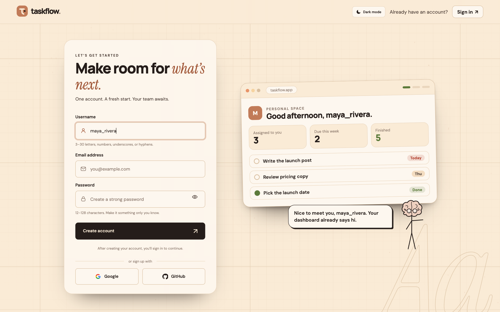 <b>Sign-up.</b> A preview that reacts as you fill in each field.</td>
  </tr>
</table>

Also included: Google and GitHub sign-in, custom roles and permissions, invitations, friends and online status, notifications, platform administration, and a public REST API with scoped tokens.

## System design

Nginx is the only service published by the stack. It terminates TLS and routes traffic to private services on the Docker network.

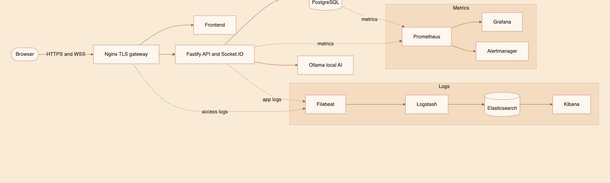

Key decisions:

- **One public entry point.** Only Nginx is published, so the app, database and operations tools stay on the private network.
- **The AI runs locally.** Workspace documents never leave the server, and no paid API is needed.
- **Permissions are enforced on the server.** Every request is checked, whatever the interface shows.
- **Concurrent edits are safe.** Task versions stop one teammate from silently overwriting another.
- **Colours come from design tokens.** Light and dark mode share the same components.

## DevOps

| Capability | Implementation |
| --- | --- |
| **Deployment** | Docker Compose with 27 app and operations services, health checks, and a one-command start |
| **Security in transit** | HTTPS everywhere through Nginx, with mutual TLS in the logging pipeline |
| **Logging** | Filebeat → Logstash → Elasticsearch → Kibana, with roles, 30-day retention and snapshot archives |
| **Monitoring** | Prometheus, Grafana, Alertmanager and exporters, with 17 alert rules and optional Discord alerts |
| **Backups and recovery** | Daily PostgreSQL backups, 7-day retention, an automated restore drill and a recovery runbook |
| **CI** | Four GitHub Actions workflows: core checks, ELK, monitoring and backups |
| **Quality gates** | Unit, database and HTTPS smoke tests, plus headless Chrome checks on every page at desktop and phone width |

**Latest verification:** 66 DevOps, 73 backend, 106 database and 123 frontend tests passing. All 35 pages load cleanly at both screen sizes, with no console errors or horizontal overflow.

### Hardest problem

The full stack had to run inside an **8 GB Docker VM**, but ELK, monitoring and a local AI model don't all fit at once. I set memory limits per service, tuned model threads to the available CPUs, and built `make` workflows that switch safely between the logging and AI profiles.

## Design system

<table>
  <tr>
    <td width="50%">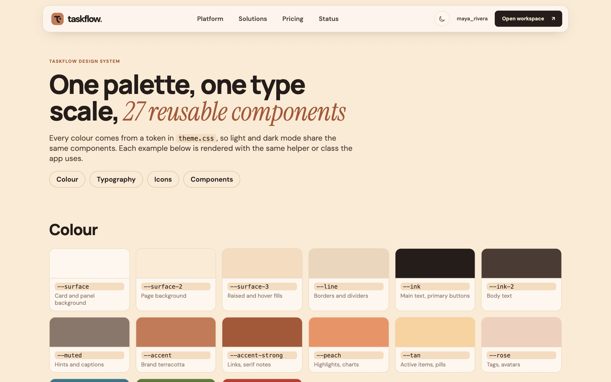</td>
    <td width="50%">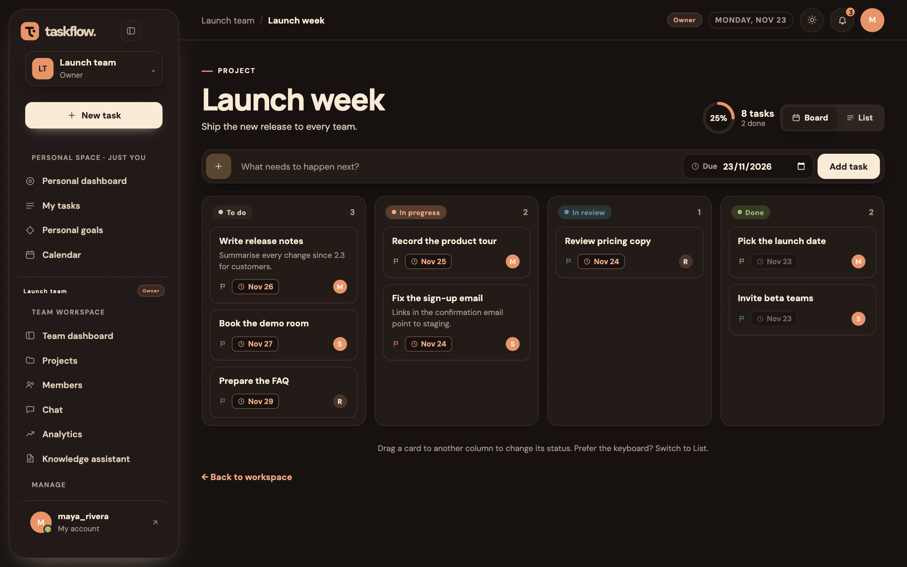</td>
  </tr>
</table>

A warm cream palette with brown ink and terracotta accents, a matching dark theme, three typefaces, 24 icons and **27 reusable components**, all documented on a live page inside the app.

  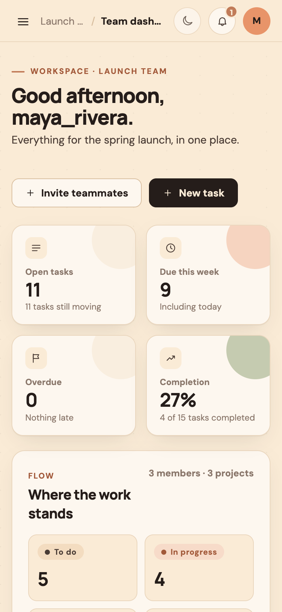
  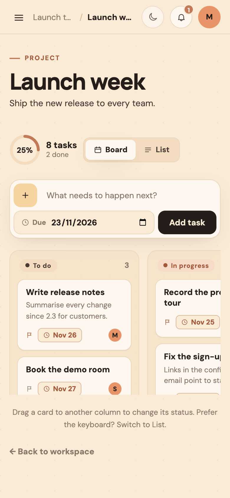
  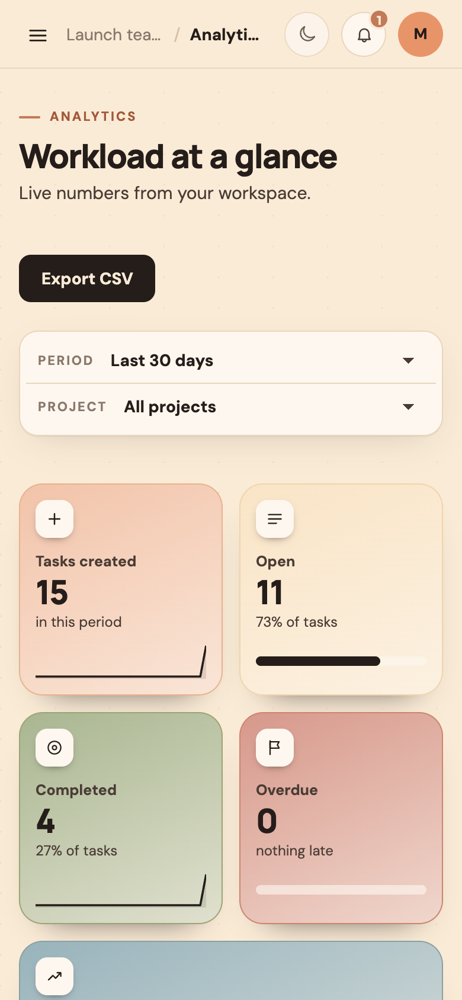

## Team

| Member | Role |
| --- | --- |
| **Abdelmoula** | Project Manager, Technical Lead, DevOps, System and Frontend Design |
| **Mohamed** | Backend: accounts, OAuth, workspaces, permissions, public API |
| **Amine** | Backend: database, real-time, chat, notifications, analytics, AI pipeline |
| **Youssef** | Frontend development and security |

## Tech stack

**Frontend:** React, Vite, JavaScript, custom CSS design system  
**Backend:** Node.js, Fastify, Socket.IO  
**Data:** PostgreSQL, Prisma  
**AI:** Ollama, hybrid keyword and vector retrieval  
**DevOps:** Docker, Nginx, GitHub Actions, Elasticsearch, Logstash, Kibana, Filebeat, Prometheus, Grafana, Alertmanager

## About this repository

This is a showcase, so the application source isn't included. AI tools, including Claude Code, assisted with scripting, fixes, testing and documentation, and the team reviewed and tested the results.

**Abdelmoula Nemili** · [GitHub](https://github.com/Abnemili)
